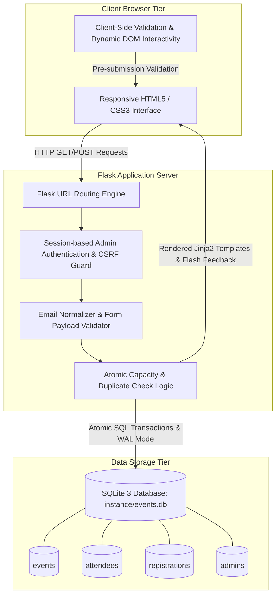
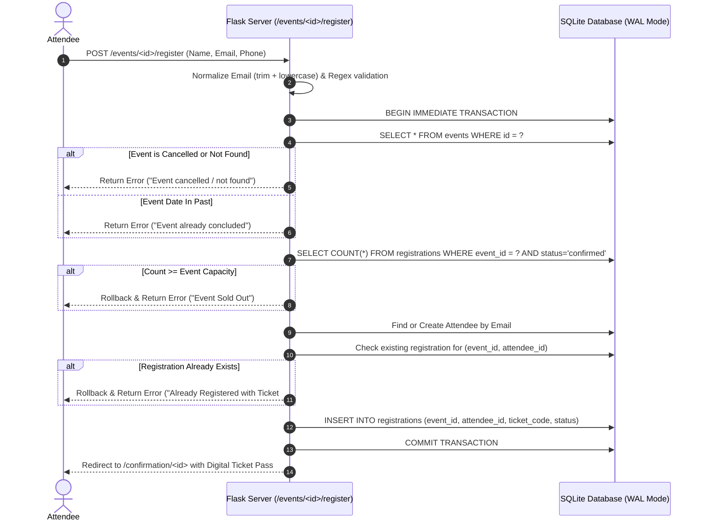
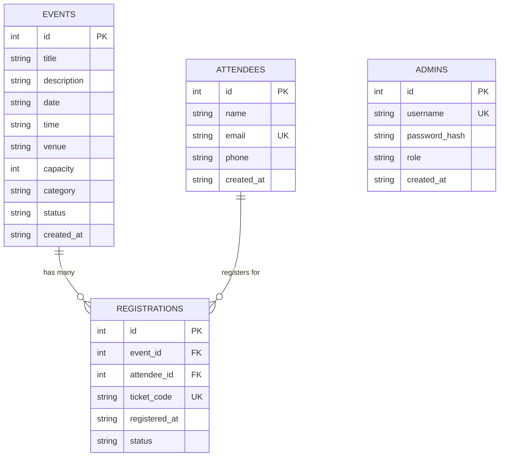

# Event Registration System: Scrum with Two Sprints
## Academic Mini-Project Report & Comprehensive Scrum Deliverables

---

## 1. Executive Summary & Problem Statement

### 1.1 Project Title
**Event Registration System Using Agile Scrum with Two Sprints**

### 1.2 Problem Statement
Organizing campus conferences, technical seminars, hackathons, and workshops frequently suffers from disorganization: overbooking due to uncoordinated registrations, duplicate submissions by the same participant, manual seat-count tracking, and lack of attendee visibility for administrators. Traditional manual or spreadsheet-based tracking lacks atomic concurrency control, validation checks, and secure administration.

### 1.3 Project Objective
To engineer and deliver a production-ready, full-stack web application for publishing events, securing real-time seat reservations, and managing attendee rosters using an iterative **Agile Scrum methodology** executed across **two distinct sprints**:
- **Sprint 1 (Attendee Discovery & Self-Service Registration):** Delivers a functional event browsing catalog, dynamic detail view, input validation, atomic capacity verification, duplicate registration prevention, and instant digital pass issuance.
- **Sprint 2 (Administration, Security & Quality Assurance):** Delivers secure administrator session authentication, comprehensive event CRUD lifecycle operations (create, edit, cancel, delete), capacity-reduction guard rails, attendee roster inspection, and automated test verification.

---

## 2. System Architecture & Flow

### 2.1 Architectural Diagram
The system follows a Model-View-Controller (MVC) architectural pattern:



### 2.2 Registration Sequence & Atomic Transaction Flow



---

## 3. Database Design & Entity Relationship Diagram (ERD)



### Database Tables Specification
1. **`events`**:
   - `id`: INTEGER PRIMARY KEY AUTOINCREMENT
   - `title`: TEXT NOT NULL
   - `description`: TEXT NOT NULL
   - `date`: TEXT NOT NULL (YYYY-MM-DD)
   - `time`: TEXT NOT NULL (HH:MM)
   - `venue`: TEXT NOT NULL
   - `capacity`: INTEGER NOT NULL (CHECK `capacity > 0`)
   - `category`: TEXT NOT NULL DEFAULT 'Technology'
   - `status`: TEXT NOT NULL DEFAULT 'open' (CHECK `status IN ('open', 'cancelled', 'completed')`)
   - `created_at`: TEXT NOT NULL

2. **`attendees`**:
   - `id`: INTEGER PRIMARY KEY AUTOINCREMENT
   - `name`: TEXT NOT NULL
   - `email`: TEXT NOT NULL UNIQUE COLLATE NOCASE
   - `phone`: TEXT
   - `created_at`: TEXT NOT NULL

3. **`registrations`**:
   - `id`: INTEGER PRIMARY KEY AUTOINCREMENT
   - `event_id`: INTEGER NOT NULL REFERENCES `events(id)` ON DELETE CASCADE
   - `attendee_id`: INTEGER NOT NULL REFERENCES `attendees(id)` ON DELETE CASCADE
   - `ticket_code`: TEXT NOT NULL UNIQUE
   - `registered_at`: TEXT NOT NULL
   - `status`: TEXT NOT NULL DEFAULT 'confirmed' (CHECK `status IN ('confirmed', 'cancelled')`)
   - `UNIQUE(event_id, attendee_id)`: Enforces business rule preventing duplicate registrations.

4. **`admins`**:
   - `id`: INTEGER PRIMARY KEY AUTOINCREMENT
   - `username`: TEXT NOT NULL UNIQUE COLLATE NOCASE
   - `password_hash`: TEXT NOT NULL (Werkzeug PBKDF2/SHA256)
   - `role`: TEXT NOT NULL DEFAULT 'admin'
   - `created_at`: TEXT NOT NULL

---

## 4. Scrum Framework Implementation

### 4.1 Team Roles & Allocation
| Role | Responsibilities |
|---|---|
| **Scrum Master / Facilitator** | Facilitates daily stand-ups, backlog grooming, sprint planning, removes blockers, and ensures Scrum compliance. |
| **Product Owner** | Defines user stories, sets acceptance criteria, prioritizes backlog, and validates deliverables against the Definition of Done. |
| **Frontend Developer** | Designs CSS3 glassmorphism design system, responsive templates, client-side validation, and digital ticket pass. |
| **Backend & Database Engineer** | Develops Flask routes, SQLite schema, atomic transactions, authentication decorators, and automated pytest suites. |

### 4.2 Definition of Done (DoD)
A User Story is accepted as **DONE** only when:
1. Feature implementation satisfies all specified acceptance criteria.
2. Server-side and client-side input validations are enforced with user-friendly error prompts.
3. Database transactions maintain ACID guarantees (no phantom overbookings).
4. Code passes automated test execution without failures.
5. All sensitive credentials are kept out of source code.
6. The user interface is tested across desktop and mobile viewports.

---

## 5. Product Backlog

| Story ID | User Story Description | Priority | Story Points | Sprint Target | Status |
|:---:|---|:---:|:---:|:---:|:---:|
| **US01** | *As a visitor, I want to view upcoming events with search and category filters so that I can easily discover relevant events.* | High | 3 | Sprint 1 | **DONE** |
| **US02** | *As a visitor, I want to see detailed event information (date, venue, remaining seats) so that I can decide whether to attend.* | High | 2 | Sprint 1 | **DONE** |
| **US03** | *As an attendee, I want to register for an event using my name and email so that I can secure my seat.* | High | 5 | Sprint 1 | **DONE** |
| **US04** | *As an attendee, I want to receive an instant registration confirmation and digital ticket pass with a unique verification code.* | High | 2 | Sprint 1 | **DONE** |
| **US05** | *As an attendee, I want duplicate submissions and full-event registrations to be rejected so that system fairness is guaranteed.* | High | 3 | Sprint 1 | **DONE** |
| **US06** | *As an administrator, I want to log in securely with password hashing and session management so that admin functions are protected.* | High | 3 | Sprint 2 | **DONE** |
| **US07** | *As an administrator, I want to create new events and update existing event details with capacity guard rules.* | High | 5 | Sprint 2 | **DONE** |
| **US08** | *As an administrator, I want to cancel or delete events safely, closing registrations while handling attendee records properly.* | Medium | 3 | Sprint 2 | **DONE** |
| **US09** | *As an administrator, I want to view attendee lists and live registration counts for each event to plan venue logistics.* | High | 3 | Sprint 2 | **DONE** |
| **US10** | *As a user, I want a responsive, accessible, and modern dark-mode aesthetic with live feedback banners and progress indicators.* | Medium | 3 | Sprint 2 | **DONE** |
| **Total**| **Complete Scope (10 User Stories)** | — | **32 pts** | — | **100% DONE** |

---

## 6. Sprint 1 Execution Report

- **Sprint Goal:** Deliver a working public event discovery and self-service registration MVP.
- **Sprint Duration:** Week 1 (Sprint Backlog: US01, US02, US03, US04, US05 — Total 15 Story Points)

### 6.1 Sprint 1 Task Board (Burn-down)
```
[Backlog] --------> [In Progress] --------> [Done]
US01 (Listing)        -                     US01 [Done]
US02 (Details)        -                     US02 [Done]
US03 (Registration)   -                     US03 [Done]
US04 (Confirmation)   -                     US04 [Done]
US05 (Capacity Check) -                     US05 [Done]
```

### 6.2 Sprint 1 Deliverables Completed
1. SQLite relational database initialized with `events`, `attendees`, and `registrations` tables.
2. Flask web application set up with parameterized database abstraction layer.
3. Responsive homepage featuring dynamic search bar, category filtering (Technology, Workshop, Seminar, Cultural), and live seat progress bars.
4. Comprehensive Event Details page showing venue, schedule, and live capacity countdown.
5. Registration form with client-side regex checks and server-side atomic transactions.
6. Digital ticket pass voucher page with ticket code format `TKT-XXX-XXXXXX`, barcode simulation, and print trigger.
7. Unit tests for event listing, registration, duplicate checks, and full-capacity blocking.

### 6.3 Sprint 1 Review & Retrospective
- **What went well:**
  - Database transactional locking (`BEGIN IMMEDIATE`) successfully prevented race conditions when booking the last remaining seat.
  - The digital ticket pass design received enthusiastic peer feedback during the demo.
- **What could be improved:**
  - Input forms needed inline field-level feedback rather than just generic page-level flash alerts.
  - Admins had no UI to create new events; test data had to be seeded via scripts.
- **Action items for Sprint 2:**
  - Build the full admin dashboard with secure authentication and CRUD interfaces.
  - Implement strict capacity-reduction validation so admins cannot reduce capacity below existing bookings.

---

## 7. Sprint 2 Execution Report

- **Sprint Goal:** Complete administrator operations, authentication security, edge case handling, and automated test suite.
- **Sprint Duration:** Week 2 (Sprint Backlog: US06, US07, US08, US09, US10 — Total 17 Story Points)

### 7.1 Sprint 2 Task Board (Burn-down)
```
[Backlog] --------> [In Progress] --------> [Done]
US06 (Admin Auth)     -                     US06 [Done]
US07 (Event CRUD)     -                     US07 [Done]
US08 (Cancel/Delete)  -                     US08 [Done]
US09 (Attendee Roster)-                     US09 [Done]
US10 (Polished UI/UX) -                     US10 [Done]
```

### 7.2 Sprint 2 Deliverables Completed
1. Secure administrator authentication using Werkzeug password hashing and `@login_required` route decorator.
2. Administrator Dashboard with KPI stat counters (Total Events, Active Events, Total Bookings, Unique Attendees).
3. Event Creation and Event Editing forms with business rule validation:
   - Enforced rule: `new_capacity >= current_confirmed_registrations`.
4. Event Cancellation (marks status as `cancelled`, disabling public registrations while preserving attendance logs) and Event Deletion (safely removes event with cascade delete).
5. Dedicated Attendee Roster page for each event with real-time table search, contact emails, and timestamped registration logs.
6. Global UI/UX polish: Glassmorphism surface styling, subtle hover elevations, responsive layouts, and accessible color contrasts.
7. Automated pytest test suite executing 14 test cases covering all edge cases.

### 7.3 Sprint 2 Review & Retrospective
- **What went well:**
  - 100% of user stories accepted against the Definition of Done.
  - Automated test suite executes in under 3 seconds with 14/14 test cases passing.
  - Zero external heavyweight dependencies; runs seamlessly on standard Python 3.10+.
- **Key Lessons Learned:**
  - Clear separation of concerns between `database.py` (transactional data layer) and `app.py` (routing & HTTP handling) dramatically simplified test authoring and debugging.
  - Early Definition of Done prevented scope creep and kept development tightly focused on core MVP functionality.

---

## 8. Test Plan & Execution Matrix

The following test execution matrix represents automated tests run using `pytest -v tests/test_app.py`:

| Test ID | Test Scenario Description | Input / Trigger | Expected Result | Actual Result | Status |
|:---:|---|---|---|---|:---:|
| **TC-01** | Open Homepage | `GET /` | Upcoming events and metrics displayed | All events and KPI cards rendered | **PASS** |
| **TC-02** | Open Event Details | `GET /events/1` | Event title, description, venue, and capacity shown | Accurate details & capacity progress shown | **PASS** |
| **TC-03** | Valid Registration | `POST /events/1/register` with valid name & email | Registration saved, digital ticket issued | Ticket `TKT-001-XXXXXX` generated & displayed | **PASS** |
| **TC-04** | Empty Form Submission | `POST /events/1/register` with empty fields | Rejected with clear validation error message | HTTP 200, error flash message shown | **PASS** |
| **TC-05** | Duplicate Registration Prevention | Register identical email twice for same event | Second registration rejected with duplicate warning | "You are already registered" message displayed | **PASS** |
| **TC-06** | Full Event Capacity Rejection | Register when event registrations == capacity | Registration rejected with sold out notification | "Event completely sold out" message displayed | **PASS** |
| **TC-07** | Cancelled Event Registration Block | Register for event with `status='cancelled'` | Registration blocked | "Event has been cancelled" message displayed | **PASS** |
| **TC-08** | Unauthorized Admin Access | `GET /admin` without active session | Denied and redirected to `/admin/login` | Redirected (302) to login screen | **PASS** |
| **TC-09** | Admin Authentication & Logout | Valid admin credentials submitted | Session established, dashboard accessible; clean logout | Successful authentication & flash notification | **PASS** |
| **TC-10** | Admin Event Creation | `POST /admin/events/new` with event data | Event added to database and public catalog | Event appears in dashboard and homepage | **PASS** |
| **TC-11** | Admin Event Editing | `POST /admin/events/1/edit` with modified details | Updated details reflected across system | Details updated successfully | **PASS** |
| **TC-12** | Event Cancellation & Deletion | `POST /admin/events/1/cancel` and `/delete` | Event status changed to cancelled / record deleted | Registration closed; deleted event removed | **PASS** |
| **TC-13** | Empty Event Attendee Roster | `GET /admin/events/1/registrations` (0 attendees) | Friendly empty state displayed | "No Registrations Yet" card shown | **PASS** |
| **TC-14** | Capacity Reduction Constraint | Update capacity below current registrations count | Update rejected with explanatory error | Error: "Capacity cannot be reduced below current registrations" | **PASS** |

---

## 9. 5-Minute Demonstration Plan

| Time | Segment | Demonstration Content & Talking Points |
|---|---|---|
| **0:00 - 1:00** | **Project Overview & Scrum Architecture** | • Explain problem statement and project objective.<br>• Highlight two-sprint Scrum methodology (Sprint 1: Attendee MVP, Sprint 2: Admin & QA).<br>• Show tech stack: Python Flask, SQLite with WAL mode, Vanilla CSS glassmorphism. |
| **1:00 - 2:00** | **Attendee Journey & Event Discovery (Sprint 1)** | • Browse public catalog, search for events, and filter by category pill.<br>• Open "Global AI & Cloud Innovation Summit" details page.<br>• Note live capacity progress bar and verified venue details. |
| **2:00 - 3:00** | **Self-Service Registration & Edge Cases** | • Submit valid registration with name and email.<br>• Display the generated Digital Ticket Pass with ticket code `TKT-001-XXXXXX`.<br>• Demonstrate duplicate prevention: attempt registering the same email again.<br>• Demonstrate full-capacity rejection on the sold-out workshop. |
| **3:00 - 4:00** | **Admin Operations & Security (Sprint 2)** | • Access `/admin` directly to show unauthenticated redirect protection.<br>• Log in as admin (`admin` / `admin123`).<br>• View KPI statistics and live event management table.<br>• Create a new event and edit an existing event.<br>• Demonstrate the capacity-reduction guard rail.<br>• Open attendee roster to show real-time verified participant list. |
| **4:00 - 5:00** | **Scrum Deliverables & Automated Testing** | • Present the Scrum Burn-down and Product Backlog (US01-US10).<br>• Run `python -m pytest -v tests/test_app.py` in the terminal to show all 14 tests passing.<br>• Discuss future enhancements (QR code scanners, payment gateway). |

---

## 10. Future Enhancements Roadmap

1. **Automated QR Code Scanning:** Integrate Python `qrcode` library to generate scannable ticket QR codes for on-site mobile check-in.
2. **Email Delivery via SMTP/SendGrid:** Send automated HTML ticket passes directly to attendee inboxes upon registration.
3. **Waitlist Queue System:** If an event is full, allow attendees to join a priority waitlist that automatically claims seats if cancellations occur.
4. **CSV/Excel Attendee Export:** Provide a one-click button in the admin dashboard to export attendee rosters for badge printing.
5. **Payment Gateway Integration:** Support paid ticket tiers using Stripe or Razorpay webhooks.
